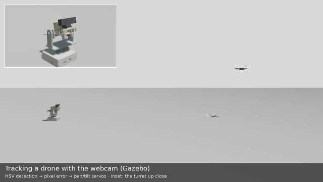
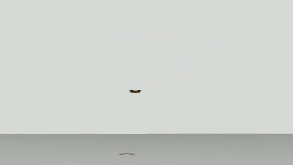
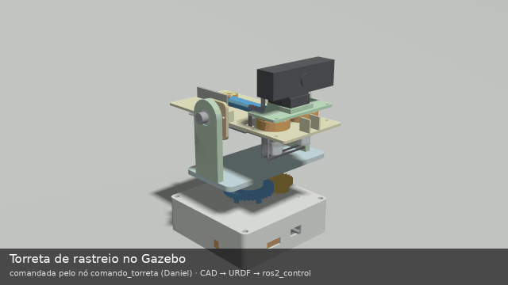
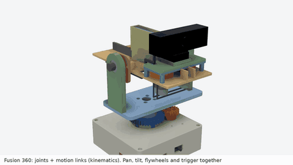
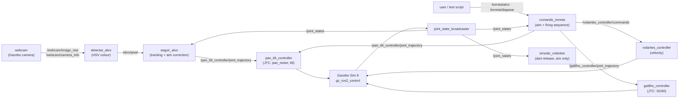
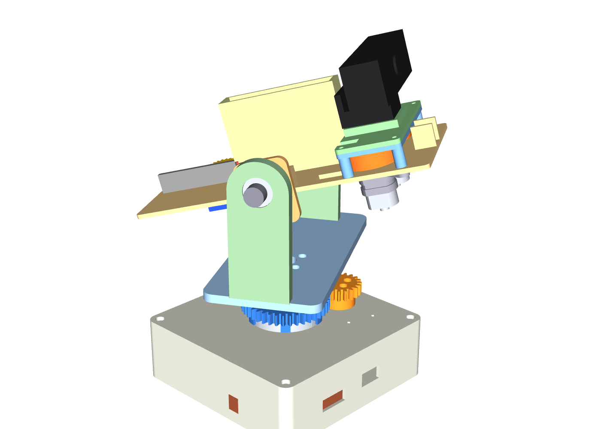
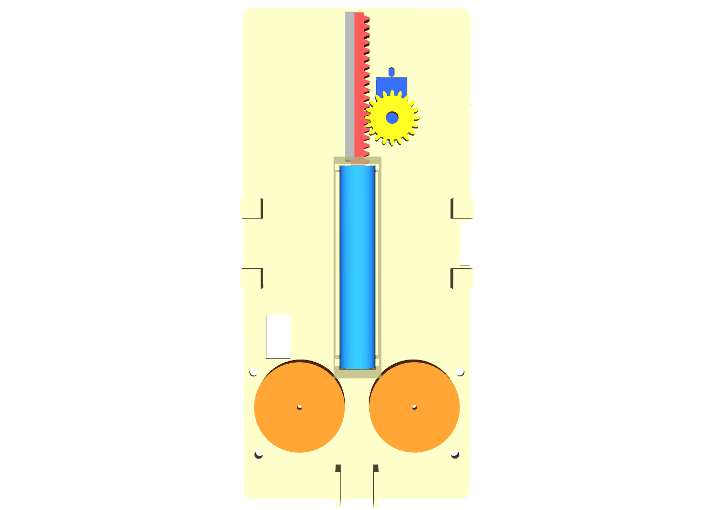

# Pan-Tilt Tracking Turret (ROS 2 + Gazebo)

> A two-axis turret with a printed flywheel launcher for foam darts, designed for 3D printing in PLA and simulated end to end in ROS 2: CAD → URDF with every gear as a joint → Gazebo + ros2_control → simulated webcam → colour detection → closed-loop tracking → ballistic aim correction → shot.

[](https://docs.ros.org/en/jazzy/)
[](https://www.python.org/)
[](https://opencv.org/)
[-E95420?logo=ubuntu&logoColor=white)](https://ubuntu.com/)
[](https://github.com/Danion1/tracking-turret-ros2/actions/workflows/ci.yml)
[](LICENSE)

🇧🇷 [Versão em português](README.pt-BR.md)

---

## Demo



What the turret's own camera sees while it tracks (the detection drives the aim; nothing reads the simulator's ground truth):



Every mechanism moves as a real joint, driven only through its motor: 20T pinion → 40T ring gear for pan, direct tilt, flywheels, rack-and-pinion pusher, dart:



Videos: [tracking + shot, real time](midia/rastreio_tiro_tempo_real.mp4) · [same shot, 8× slow motion](midia/rastreio_tiro.mp4) · [mechanisms, 24 s](midia/torreta.mp4). They are rendered by simulated cameras in lockstep with the physics, so they play smoothly even though the simulation ran on a CPU-only WSL2 machine.

### Mechanisms up close



A kinematic animation in Fusion 360 (joints + motion links), so each gear and mechanism can be seen turning up close. It is **not** a physics test: it shows the geometry and the ratios. The ratios measured in Fusion match the URDF (pinion/ring −2.000, flywheels −1, rack 10.000 mm/rad), and the teeth do not collide at 5 pan poses and 3 rack poses. The physics (motors, contacts, the dart) is in the Gazebo recordings above. [Video, 18 s](midia/torreta_fusion.mp4).

**Status:** Simulated only. CAD designed for fabrication, not printed yet. The mechanisms (gear ratios, signs, lag), the dart launch and the tracking are measured in Gazebo (numbers below). Detection on the real webcam, motion prediction (Kalman) and automatic firing are not done yet: see [Next steps](#next-steps).

*Developed in a private workspace (Nov 5–11, 2026); this repository is the cleaned public release. CI builds the ROS 2 packages and runs their tests on every push.*

---

## Overview

The goal was one model that serves both simulation and fabrication, and a simulation where every moving part is real: no mechanism is "declared", each one is a URDF joint whose ratio and sign are measured in Gazebo. The turret is designed parametrically in Python (CadQuery) from a single parameter file in which every dimension cites a datasheet or is marked ASSUMED. The same scripts produce printable STL/STEP parts, masses and inertias, and the URDF meshes.

Key points:
- **Parametric CAD in CadQuery** with checks before every export: bounding boxes, one solid per part, printer bed fit, and zero interference between all moving parts in 60 poses.
- **Every transmission is a joint**: the pan pinion and ring gear are linked by a `mimic` joint (ratio −0.5), the flywheels by −1, the pusher rack by 10 mm/rad. Commands go to the motors, like on the hardware; the driven parts follow.
- **Dart launch**: the rack pushes a free dart body into the flywheels, which release it at their rim speed along the barrel.
- **Vision loop**: HSV colour detection on the simulated webcam → pixel error → pan/tilt command, closed through the measured joint positions.
- **Ballistic aim correction**: distance estimated from the target's width in pixels, then the aim point is shifted for camera-barrel parallax and dart drop. At 3 m the miss went from 137 mm to 6 mm.

---

## Architecture



| Component | Role | Written by me / configured |
|---|---|---|
| `plano/gerar_parametros.py` | single source of dimensions (each with a datasheet source or ASSUMED) and the launcher physics checks | written (with AI assistance) |
| `cad/*.py` (CadQuery) | parts, assembly with interference check, URDF + Gazebo xacro generator, renders | written (with AI assistance) |
| `torreta_description` | URDF, meshes, Gazebo worlds, controllers, launch files, target drone, dart release script | generated by script + configured (with AI assistance) |
| `torreta_nos/comando_torreta.py` | node: turret angles → motor angles (2:1, sign), firing state machine (spin up → push → retract, 2 s timeout) | written by hand |
| `torreta_nos/detectar_alvo.py` | node: HSV detection of the target, pixel centre + width | written by hand; robustness fixes AI-assisted |
| `torreta_nos/seguir_alvo.py` | node: closed-loop tracking from the pixel error, distance from width, parallax + drop correction | written by hand; robustness fixes AI-assisted |
| `ros2/testar_*.sh`, `medir_mecanismos.py`, `conferir_camera.py` | headless measurements against ground truth | written (with AI assistance) |
| ros2_control, Gazebo, OpenCV | control, physics, vision | configured |

---

## Engineering decisions

| Decision | Alternative considered | Why |
|---|---|---|
| Pan through a 20T pinion on a 40T ring gear (m1.5) on a 6808 bearing | Servo directly under the turntable | The bearing carries the turret's weight instead of the servo shaft, and the gear pair is a visible transmission to validate; cost: ±90° of pan uses the servo's full 360° |
| Tilt directly on the servo, 608 bearing on the other arm | Gears on tilt too | Less backlash where it matters most for aim |
| Printed flywheel launcher (2 × size-130 motors, SG90 rack pusher) | Buying a commercial blaster | The launcher becomes part of the design (spin-up, compression, pusher stroke), with every number under control |
| Commercial Elite-type foam darts | Printed rigid dart | Safety (energy per tip area over the soft-tip limit), the flywheel interference would be below the printer's tolerance, larger RPM drop per shot |
| Commands on the motors; driven parts follow with `mimic` | Commanding the output joints | That is how the hardware works: the servo only knows its own angle |
| DART physics engine | Bullet-Featherstone | With the gz_ros2_control mimic, Bullet locked the joints and capped joint speed at 100 rad/s (the pusher stalled) |
| Control loop at 1 kHz | 100 Hz | At 100 Hz the mimic lag was 10 ms; at 1 kHz it is one cycle (1 ms) |
| Dart released at rim speed on contact (simulation-only script) | Physical foam–flywheel friction | Foam compression and friction are not modelled reliably in Gazebo; the simplification is declared and the release speed is measured |
| Distance from target width (known 60 mm body) | Stereo or depth camera | One webcam, as on the planned hardware |

---

## Validation

All results come from scripts that run without a GUI, in a temporary workspace and an isolated ROS domain, against ground truth published by the simulator.

| What | Method | Result |
|---|---|---|
| CAD interference | All moving parts, 60 poses of pan × tilt × firing, 724 part pairs | 0.0000 mm³ |
| URDF vs. CAD | Mesh vertices posed by the URDF vs. the CAD assembly, 18 poses | max deviation 3e-14 mm; `check_urdf` OK; total mass 1060 g (solid PLA, upper bound) |
| Transmission ratio and sign | Gazebo, ~77 000 samples at 1 kHz | pan / pan_motor −0.500000; rack / SG90 +0.010000 m/rad; flywheel / flywheel −1.000000 at 1200 rad/s |
| Transmission in motion | Same run, while moving | error ≤ 0.1 % of travel, lag ≤ 1 control cycle (1 ms), no jumps |
| Tilt holding torque | Gazebo effort at rest vs. hand calculation from URDF masses | 0.1842 vs. 0.1843 N·m |
| Firing sequence | `comando_torreta` in Gazebo | spin-up 0.71 s → push 0.32 s → retract 0.32 s (~1.35 s); forced fault aborts at 2.02 s and stops the flywheels |
| Dart launch | Free dart body, pan 0°/tilt 0° and pan 30°/tilt 20° | exit 21.59 m/s (rim 21.60), 0.00° from the barrel; flight time 1.535 s vs. 1.529 s hand calculation (no drag) |
| Simulated webcam | Ground-truth target projected with the camera model | 30.3 Hz, no dropped frames; fx = fy = 453.5 px (= calculation); target at the predicted pixel in 100 % of frames (max 3.4 px) |
| Detection | `detectar_alvo` vs. projected ground truth, figure-eight path | detected in 99.6 % of frames; mean error 1.71 px (max 3.62) |
| Tracking | `seguir_alvo`, drone moving side to side at 3 m, up to 15°/s | target always in the image; mean angular error 0.9°, max 1.73° (without tracking it would cross 164–476 px of the 640 px image) |
| Aim correction | Shot at a hovering drone; miss distance from the dart's trajectory | uncorrected at 3 m: 137 mm low (predicted 145 mm: 0.9° parallax + 1.8° drop). Corrected: 2 m → 3 mm, 3 m → 6 mm, 4 m → 9 mm (*) |
| Shot at a moving target | End of the side-to-side path, no prediction yet | hits the body (+19, +18, −7 mm), shown in the GIFs above |

(*) Measured before the last two robustness changes to `seguir_alvo`; to be re-run (see Next steps).

Reproduce (from the repository root, after building; each script builds the packages in a temporary workspace):
```bash
bash ros2/testar_gazebo.sh                        # ratios, signs, lag, holding torque (~3 min)
bash ros2/testar_disparo.sh                       # firing sequence and timeout
bash ros2/testar_dardo.sh 30 20                   # dart launch at pan 30°, tilt 20°
bash ros2/testar_rastreio.sh oito 20 detectar     # detection vs. ground truth
bash ros2/testar_rastreio.sh vaivem 20 seguir     # closed-loop tracking
bash ros2/testar_rastreio.sh parado 9 disparo 3.0 # aimed shot at a hovering drone, 3 m
bash ros2/gravar_rastreio.sh                      # records the tracking GIFs (several minutes)
```
The tracking and recording scripts cap their own memory with `systemd-run --user` (the recorders peak at ~1.4 GB).

---

## Designed for fabrication

<p align="center">
  
  
</p>

| Part | Qty | Source |
|---|---|---|
| Feetech STS3215 C001 servo (pan, tilt) | 2 | Feetech product specification A/0; geometry cross-checked with the SO-ARM100 STEP |
| Bearing 61808-2RS1 (6808), turntable | 1 | SKF catalogue 17000/1 |
| Bearing 608-2Z, tilt idler | 1 | SKF catalogue 17000/1 |
| Mabuchi FA-130RA motor (flywheels) | 2 | Mabuchi datasheet |
| TowerPro SG90 micro servo (pusher) | 1 | TowerPro product page |
| Elite-type foam dart (1.02 g, Ø13 × 73.4 mm) | — | published measurement |
| Webcam with a 1/4"-20 tripod thread | 1 | generic; field of view of a Logitech C920s as reference |
| ESP32-S3-DevKitC-1 + Waveshare bus servo adapter (in the box, hole patterns only) | 1 + 1 | Espressif, Waveshare |
| Printed parts (box, top plate, ring gear, two pinions, turntable column, arms, cradle floor and sides, motor cups, flywheels, cage, funnel, rack and its guide, webcam clip) | 20 (19 files; the flywheel is printed twice) | STL + STEP in `cad_export/` |

Every value used in the CAD, with its source link and the document item it was read from, is in [fontes/FONTES.md](fontes/FONTES.md) (in Portuguese) and, structured, in [fontes/componentes.json](fontes/componentes.json). Manufacturer PDFs are not redistributed; the links are. All parts fit the Flashforge Inventor bed (230 × 150 × 160 mm); clearances that depend on the printer are marked ASSUMED, to be tuned after a test print. **Not built yet.**

---

## Tech stack

- **Robotics:** ROS 2 Jazzy, ros2_control, Gazebo Sim 8 (gz_ros2_control, DART), RViz2
- **Vision:** OpenCV (HSV thresholding, contours), cv_bridge
- **CAD:** CadQuery (Python, OpenCASCADE)
- **Languages:** Python 3.12, URDF/Xacro, SDF, YAML
- **Environment:** Ubuntu 24.04 on WSL2 (WSLg for GUIs), CPU only

---

## Getting started

### Prerequisites
- ROS 2 Jazzy (`source /opt/ros/jazzy/setup.bash`)
- `sudo apt install ros-jazzy-ros-gz ros-jazzy-gz-ros2-control ros-jazzy-ros2-controllers ros-jazzy-xacro ros-jazzy-cv-bridge python3-opencv`
- To regenerate the CAD: a Python venv with CadQuery (`pip install cadquery`)

### Build
```bash
git clone https://github.com/Danion1/tracking-turret-ros2.git
mkdir -p ~/ros2_ws/src
ln -s "$PWD"/tracking-turret-ros2/ros2/torreta_* ~/ros2_ws/src/
cd ~/ros2_ws
colcon build --symlink-install
source install/setup.bash
```

### Run
```bash
# Just look at the model: RViz2 with sliders for every motor joint
ros2 launch torreta_description display.launch.py

# Terminal 1: Gazebo with the webcam and a drone moving side to side 3 m away
ros2 launch torreta_description rastreio.launch.py modo:=vaivem distancia:=3.0   # modo: parado | vaivem | circulo | oito

# Terminals 2-4: detection, tracking, firing
ros2 run torreta_nos detectar_alvo --ros-args -p use_sim_time:=true
ros2 run torreta_nos seguir_alvo --ros-args -p use_sim_time:=true
ros2 run torreta_nos comando_torreta --ros-args -p use_sim_time:=true

# Fire once
ros2 topic pub --once /torreta/disparar std_msgs/msg/Empty "{}"
```
Without the tracker, aim by hand in turret angles: `ros2 topic pub --once /torreta/alvo std_msgs/msg/Float64MultiArray "{data: [30.0, 10.0]}"` (pan ±90°, tilt −20° to 40°; out-of-range targets are refused).

### Check it is working
```bash
ros2 control list_controllers   # joint_state_broadcaster, pan_tilt_controller, volantes_controller, gatilho_controller: active
ros2 topic echo --once /alvo/pixel
```

### Regenerate the CAD (optional)
The meshes, URDF and STL/STEP files are already in the repository. To rebuild them (each script checks its result before exporting):
```bash
cd plano && python gerar_parametros.py && cd ../cad      # parameters → plano/parametros.json
python pan.py && python tampo.py && python caixa.py && python mesa_bracos.py \
  && python berco.py && python lancador.py && python webcam.py   # parts → cad_export/
python montagem.py      # assembly + interference in 60 poses (~4 min)
python gerar_urdf.py    # URDF, meshes, Gazebo xacro, controller and camera checks
```

---

## Repository structure

```text
plano/        parameter generator (every dimension with its source) and the generated parametros.json
cad/          CadQuery scripts: parts, assembly, URDF/xacro generator, renders
cad/lib/      shared CAD modules used here (checks, STL export, mass/inertia, ISO screws, gears, renders)
cad_export/   printable parts and the assembly, STL + STEP
fontes/       sources for every component value; servo STEP from SO-ARM100 (Apache-2.0)
ros2/         ROS 2 packages (torreta_description, torreta_nos) + headless test and recording scripts
midia/        GIFs and videos
docs/img/     README images
```

`cad/lib/` is a frozen copy of the modules this project uses from my shared CAD library (taken from commit `a50cc3d`, 2026-11-11). `fontes/STS3215_03a_SO-ARM100.step` is the servo model from [TheRobotStudio/SO-ARM100](https://github.com/TheRobotStudio/SO-ARM100) (Apache License 2.0), used unchanged as a geometry reference; it is embedded in the assembly STEP and in two URDF meshes. Code identifiers and comments are in Portuguese, my native language; this README is in English.

---

## Limitations

- Simulated only; nothing has been built or tested on hardware.
- The dart does not touch the flywheels physically: on contact, a simulation-only script gives it the measured rim speed along the barrel (the real launcher will lose some speed to slip; the design estimate is 85 %, 19.7 m/s). There is no air drag, and the dart is removed when it hits the ground or the target (bouncing at 20 m/s crashed the physics).
- The target is an orange drone model with dark propellers: colour detection only, no classifier. Seen from below, the orange reads as brown, so the HSV range is tuned to this scene.
- No motion prediction yet: the shot at the moving drone hits because it is fired at the end of the path, where the drone slows down.
- Distance comes from the target's apparent width (known 60 mm body): −6.5 % error at 3 m, clamped to 1–6 m.
- The ±90° pan uses the servo's full 360° range (2:1 gearing), so there is no spare servo travel.
- Masses assume solid PLA (upper bound). Camera resolution (640 × 360 at 30 Hz), the dart friction coefficient and the pusher "grip" (2 mm past the flywheel contact) are assumed.
- The flake8 style check of the ROS 2 nodes does not pass yet and is skipped in CI (formatting only).

---

## Next steps

- [x] Fabrication-ready parametric CAD with datasheet sources and zero interference
- [x] URDF with every transmission as a joint, ratios and signs measured in Gazebo
- [x] Firing sequence and free dart launch
- [x] Simulated webcam, colour detection, closed-loop tracking, parallax + drop correction
- [ ] Re-run the hovering-drone shots at 2, 3 and 4 m with the final `seguir_alvo`
- [ ] Kalman filter + lead prediction (firing sequence ~1.35 s + flight ~0.14 s) to hit a moving target anywhere on its path
- [ ] Automatic firing when the predicted error is small
- [ ] Detection and latency on the real webcam, measured on CPU
- [ ] Make the nodes pass flake8 and enable it in CI
- [ ] Print and assemble; swap `GazeboSimSystem` for the Feetech bus servo hardware interface

---

## How AI was used

I chose the project and made the design decisions: pan through a 2:1 gear pair on a bearing, direct tilt, a printed flywheel launcher, commercial foam darts instead of printed ones, commanding the motors rather than the outputs, and testing every mechanism as a joint. I wrote the three ROS 2 nodes by hand (aim and firing state machine, detection, tracking with the parallax and drop correction), after which an AI assistant (Claude) reviewed them; it also made two robustness fixes in the detection and tracking nodes at my request, marked in the code. The CAD generators, URDF/xacro, controller configuration and the measurement scripts were written with the AI assistant as a pair programmer, from my specifications, one part at a time with my review. Nothing was accepted on trust: every result is checked automatically against independent references (CAD solids, hand calculations, datasheets, simulator ground truth).

---

## Author

**Daniel Dos Santos Da Silva** · [GitHub](https://github.com/Danion1) · [LinkedIn](https://www.linkedin.com/in/daniel-dos-santos-da-silva-32a2b23ba/) · [danion.neros@gmail.com](mailto:danion.neros@gmail.com)

## License

Apache License 2.0 — see [LICENSE](LICENSE). The servo STEP model in `fontes/` is from SO-ARM100, also Apache 2.0.
