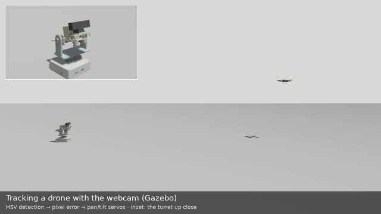
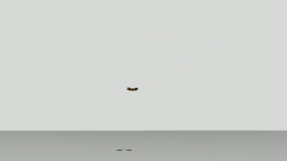
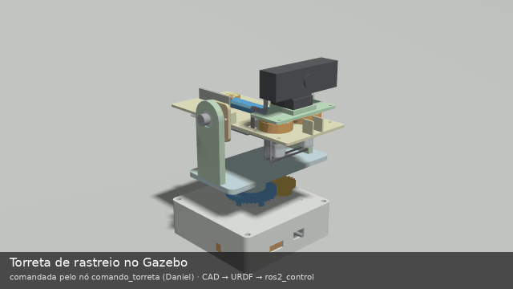
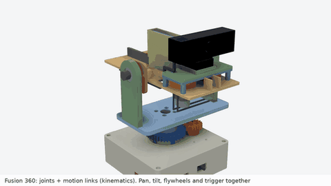
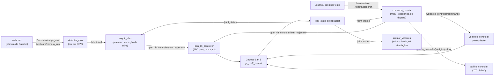
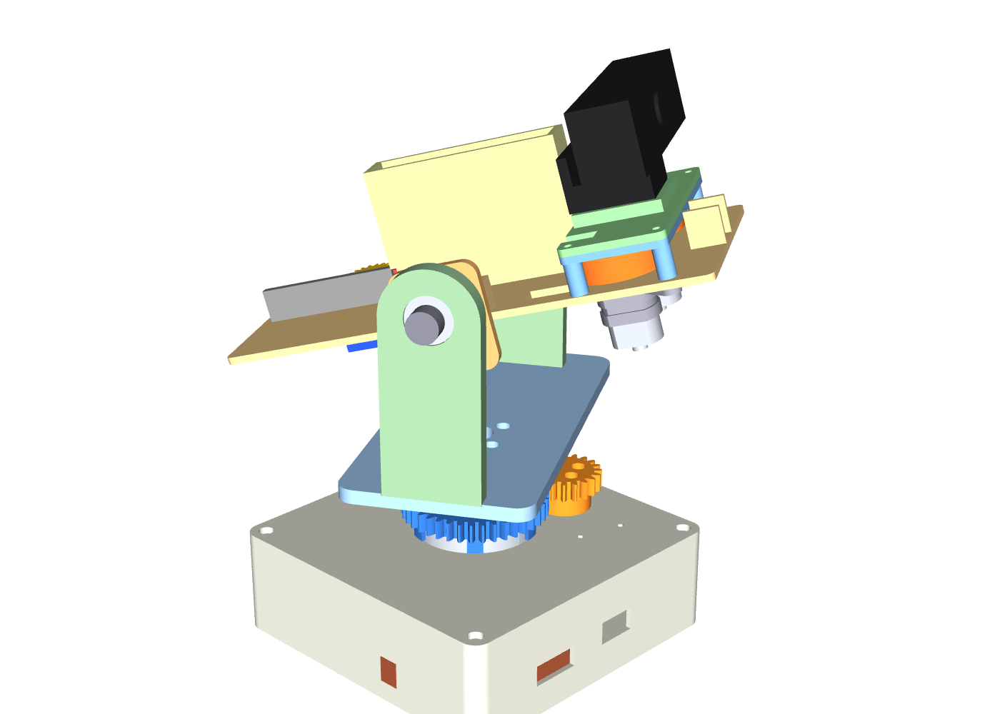
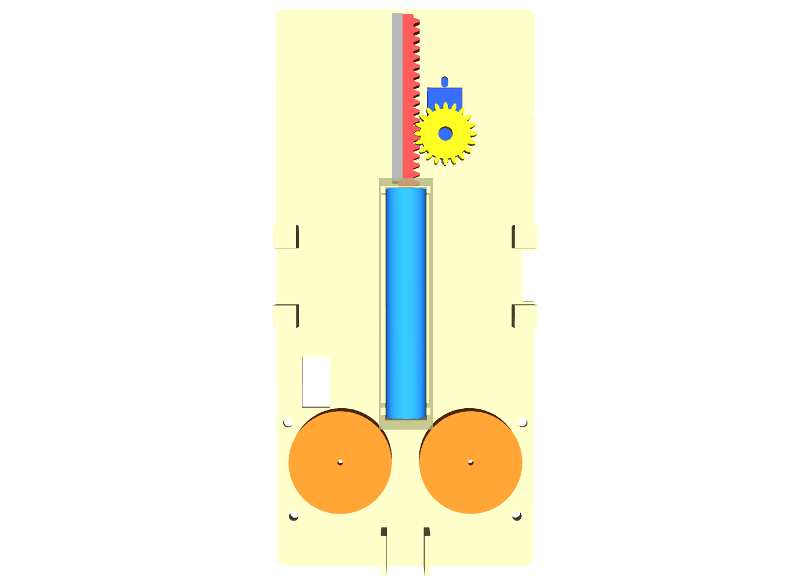

# Torreta de rastreio pan-tilt (ROS 2 + Gazebo)

> Torreta de dois eixos com lançador de volantes impresso para dardos de espuma, projetada para impressão 3D em PLA e simulada de ponta a ponta no ROS 2: CAD → URDF com cada engrenagem como junta → Gazebo + ros2_control → webcam simulada → detecção por cor → rastreio em malha fechada → correção balística da mira → tiro.

[](https://docs.ros.org/en/jazzy/)
[](https://www.python.org/)
[](https://opencv.org/)
[-E95420?logo=ubuntu&logoColor=white)](https://ubuntu.com/)
[](https://github.com/Danion1/tracking-turret-ros2/actions/workflows/ci.yml)
[](LICENSE)

🇺🇸 [English version](README.md)

---

## Demonstração



O que a câmera da própria torreta vê enquanto rastreia (a detecção comanda a mira; nada lê a verdade do simulador):



Cada mecanismo se move como junta de verdade, comandado só pelo seu motor: pinhão 20T → coroa 40T no pan, tilt direto, volantes, empurrador de pinhão e cremalheira, dardo:



Vídeos: [rastreio + tiro, tempo real](midia/rastreio_tiro_tempo_real.mp4) · [mesmo tiro, 8× mais lento](midia/rastreio_tiro.mp4) · [mecanismos, 24 s](midia/torreta.mp4). São gravados por câmeras simuladas em sincronia com a física, então rodam lisos mesmo com a simulação feita num WSL2 só com CPU.

### Mecanismos de perto



Animação cinemática no Fusion 360 (juntas + motion links), para ver de perto cada engrenagem e cada mecanismo girando. **Não** é teste de física: mostra a geometria e as relações. As relações medidas no Fusion conferem com o URDF (pinhão/coroa −2,000, volantes −1, cremalheira 10,000 mm/rad), e os dentes não colidem em 5 poses do pan e em 3 da cremalheira. A física (motores, contatos, o dardo) está nas gravações do Gazebo acima. [Vídeo, 18 s](midia/torreta_fusion.mp4).

**Estado:** só simulado. CAD pronto para fabricar, ainda não impresso. Os mecanismos (razões, sinais, atraso), o lançamento do dardo e o rastreio estão medidos no Gazebo (números abaixo). Detecção na webcam real, previsão de movimento (Kalman) e disparo automático ainda não foram feitos: ver [Próximos passos](#próximos-passos).

*Desenvolvido num espaço de trabalho privado (5 a 11 de nov. de 2026); este repositório é a versão pública limpa. O CI compila os pacotes ROS 2 e roda os testes a cada push.*

---

## Visão geral

O objetivo era um modelo único para simular e fabricar, e uma simulação em que toda peça móvel é real: nenhum mecanismo é "declarado", cada um é uma junta do URDF com razão e sinal medidos no Gazebo. A torreta é paramétrica em Python (CadQuery), a partir de um único arquivo de parâmetros em que cada cota cita um datasheet ou vem marcada ASSUMIDO. Os mesmos scripts geram as peças em STL/STEP, as massas e inércias e as malhas do URDF.

Pontos principais:
- **CAD paramétrico em CadQuery** com conferências antes de cada exportação: caixa envolvente, um sólido por peça, cabe na mesa da impressora, e interferência zero entre todas as peças móveis em 60 poses.
- **Toda transmissão é junta**: pinhão e coroa do pan ligados por `mimic` (razão −0,5), volantes por −1, cremalheira do empurrador por 10 mm/rad. O comando vai nos motores, como no hardware; o resto segue.
- **Lançamento do dardo**: a cremalheira empurra um dardo solto até os volantes, que o soltam na velocidade da borda, na direção do cano.
- **Malha de visão**: detecção por cor em HSV na webcam simulada → erro em pixels → comando de pan/tilt, fechado pela posição medida das juntas.
- **Correção balística da mira**: distância estimada pela largura do alvo em pixels; o ponto de mira é deslocado pela paralaxe câmera-cano e pela queda do dardo. A 3 m, a falta caiu de 137 mm para 6 mm.

---

## Arquitetura



| Componente | Papel | Escrito por mim / configurado |
|---|---|---|
| `plano/gerar_parametros.py` | fonte única das cotas (cada uma com datasheet ou ASSUMIDO) e as contas do lançador | escrito (com assistência de IA) |
| `cad/*.py` (CadQuery) | peças, montagem com conferência de interferência, gerador do URDF e do xacro do Gazebo, renders | escrito (com assistência de IA) |
| `torreta_description` | URDF, malhas, mundos do Gazebo, controladores, launch, drone alvo, script que solta o dardo | gerado por script + configurado (com assistência de IA) |
| `torreta_nos/comando_torreta.py` | nó: ângulos da torre → ângulos dos motores (2:1, sinal), máquina de estados do disparo (acelera → empurra → recolhe, timeout de 2 s) | escrito à mão |
| `torreta_nos/detectar_alvo.py` | nó: detecção do alvo em HSV, centro e largura em pixels | escrito à mão; correções de robustez com IA |
| `torreta_nos/seguir_alvo.py` | nó: rastreio em malha fechada pelo erro em pixels, distância pela largura, correção de paralaxe e queda | escrito à mão; correções de robustez com IA |
| `ros2/testar_*.sh`, `medir_mecanismos.py`, `conferir_camera.py` | medições sem janela contra a verdade do simulador | escrito (com assistência de IA) |
| ros2_control, Gazebo, OpenCV | controle, física, visão | configurado |

---

## Decisões de engenharia

| Decisão | Alternativa considerada | Por quê |
|---|---|---|
| Pan por pinhão 20T numa coroa 40T (m1,5) sobre rolamento 6808 | Servo direto sob a mesa | O rolamento carrega o peso da torre, não o eixo do servo, e o par de engrenagens é uma transmissão visível para validar; custo: ±90° de pan usa os 360° inteiros do servo |
| Tilt direto no servo, rolamento 608 no outro braço | Engrenagem no tilt também | Menos folga onde mais importa para a mira |
| Lançador de volantes impresso (2 motores 130, empurrador de cremalheira com SG90) | Comprar um lançador pronto | O lançador vira parte do projeto (aceleração, compressão, curso do empurrador), com todos os números sob controle |
| Dardo de espuma comercial tipo Elite | Dardo rígido impresso | Segurança (energia por área da ponta acima do limite de ponta macia), interferência no volante abaixo da tolerância da impressora, queda de rotação maior por tiro |
| Comando nos motores; o resto segue com `mimic` | Comandar as juntas de saída | É como o hardware funciona: o servo só conhece o próprio ângulo |
| Física DART | Bullet-Featherstone | Com a mimic do gz_ros2_control, o Bullet travava as juntas e limitava a 100 rad/s (o empurrador parava) |
| Controle a 1 kHz | 100 Hz | A 100 Hz o atraso da mimic era 10 ms; a 1 kHz é um ciclo (1 ms) |
| Dardo solto na velocidade da borda ao tocar (script só de simulação) | Atrito físico espuma-volante | Compressão e atrito da espuma não são confiáveis no Gazebo; a simplificação é declarada e a velocidade de saída é medida |
| Distância pela largura do alvo (corpo de 60 mm conhecido) | Câmera estéreo ou de profundidade | Uma webcam só, como no hardware planejado |

---

## Validação

Todos os resultados vêm de scripts que rodam sem janela, num workspace temporário e num domínio ROS isolado, contra a verdade publicada pelo simulador.

| O quê | Método | Resultado |
|---|---|---|
| Interferência no CAD | Todas as peças móveis, 60 poses de pan × tilt × disparo, 724 pares de peças | 0,0000 mm³ |
| URDF × CAD | Vértices das malhas posados pelo URDF × montagem do CAD, 18 poses | desvio máx. 3e-14 mm; `check_urdf` OK; massa total 1 060 g (PLA maciço, limite de cima) |
| Razão e sinal das transmissões | Gazebo, ~77 000 amostras a 1 kHz | pan / pan_motor −0,500000; cremalheira / SG90 +0,010000 m/rad; volante / volante −1,000000 a 1 200 rad/s |
| Transmissões em movimento | Mesma rodada, em movimento | erro ≤ 0,1 % do curso, atraso ≤ 1 ciclo de controle (1 ms), nenhum salto |
| Torque do tilt parado | Esforço no Gazebo × conta à mão pelas massas do URDF | 0,1842 × 0,1843 N·m |
| Sequência de disparo | `comando_torreta` no Gazebo | acelera 0,71 s → empurra 0,32 s → recolhe 0,32 s (~1,35 s); falha forçada aborta em 2,02 s e desliga os volantes |
| Lançamento do dardo | Dardo solto, pan 0°/tilt 0° e pan 30°/tilt 20° | saída 21,59 m/s (borda 21,60), 0,00° do cano; voo 1,535 s × 1,529 s da conta à mão (sem arrasto) |
| Webcam simulada | Alvo verdadeiro projetado pelo modelo da câmera | 30,3 Hz, sem quadro perdido; fx = fy = 453,5 px (= conta); alvo no pixel previsto em 100 % dos quadros (máx. 3,4 px) |
| Detecção | `detectar_alvo` × verdade projetada, trajetória em oito | detectado em 99,6 % dos quadros; erro médio 1,71 px (máx. 3,62) |
| Rastreio | `seguir_alvo`, drone indo e voltando a 3 m, até 15°/s | alvo sempre na imagem; erro angular médio 0,9°, máx. 1,73° (sem rastreio ele cruzaria de 164 a 476 px dos 640 da imagem) |
| Correção da mira | Tiro no drone parado; falta medida pela trajetória do dardo | sem correção, a 3 m: 137 mm abaixo (previsto 145 mm: 0,9° de paralaxe + 1,8° de queda). Com correção: 2 m → 3 mm, 3 m → 6 mm, 4 m → 9 mm (*) |
| Tiro no alvo em movimento | Fim do vaivém, ainda sem previsão | acerta o corpo (+19, +18, −7 mm), visível nos GIFs acima |

(*) Medido antes das duas últimas mudanças de robustez no `seguir_alvo`; a refazer (ver Próximos passos).

Para reproduzir (da raiz do repositório; cada script compila os pacotes num workspace temporário):
```bash
bash ros2/testar_gazebo.sh                        # razões, sinais, atraso, torque parado (~3 min)
bash ros2/testar_disparo.sh                       # sequência de disparo e timeout
bash ros2/testar_dardo.sh 30 20                   # lançamento com pan 30°, tilt 20°
bash ros2/testar_rastreio.sh oito 20 detectar     # detecção × verdade
bash ros2/testar_rastreio.sh vaivem 20 seguir     # rastreio em malha fechada
bash ros2/testar_rastreio.sh parado 9 disparo 3.0 # tiro corrigido no drone parado a 3 m
bash ros2/gravar_rastreio.sh                      # grava os GIFs do rastreio (vários minutos)
```
Os scripts de rastreio e de gravação limitam a própria memória com `systemd-run --user` (as gravações chegam a ~1,4 GB).

---

## Pronto para fabricar

<p align="center">
  
  
</p>

| Peça | Qtd. | Fonte |
|---|---|---|
| Servo Feetech STS3215 C001 (pan, tilt) | 2 | especificação Feetech A/0; geometria conferida com o STEP do SO-ARM100 |
| Rolamento 61808-2RS1 (6808), mesa giratória | 1 | catálogo SKF 17000/1 |
| Rolamento 608-2Z, apoio do tilt | 1 | catálogo SKF 17000/1 |
| Motor Mabuchi FA-130RA (volantes) | 2 | datasheet Mabuchi |
| Micro servo TowerPro SG90 (empurrador) | 1 | página da TowerPro |
| Dardo de espuma tipo Elite (1,02 g, Ø13 × 73,4 mm) | — | medição publicada |
| Webcam com rosca de tripé 1/4"-20 | 1 | genérica; campo de visão da Logitech C920s como referência |
| ESP32-S3-DevKitC-1 + adaptador de barramento Waveshare (na caixa, só furação) | 1 + 1 | Espressif, Waveshare |
| Peças impressas (caixa, tampo, coroa, dois pinhões, coluna da mesa, braços, piso e faces do berço, copos dos motores, volantes, gaiola, funil, cremalheira e guia, clipe da webcam) | 20 (19 arquivos; o volante é impresso duas vezes) | STL + STEP em `cad_export/` |

Cada valor usado no CAD, com o link da fonte e o item do documento de onde foi lido, está em [fontes/FONTES.md](fontes/FONTES.md) e, estruturado, em [fontes/componentes.json](fontes/componentes.json). Os PDFs dos fabricantes não são redistribuídos; os links sim. Todas as peças cabem na mesa da Flashforge Inventor (230 × 150 × 160 mm); as folgas que dependem da impressora estão marcadas ASSUMIDO, para ajustar depois de uma impressão de teste. **Ainda não construída.**

---

## Tecnologias

- **Robótica:** ROS 2 Jazzy, ros2_control, Gazebo Sim 8 (gz_ros2_control, DART), RViz2
- **Visão:** OpenCV (limiar em HSV, contornos), cv_bridge
- **CAD:** CadQuery (Python, OpenCASCADE)
- **Linguagens:** Python 3.12, URDF/Xacro, SDF, YAML
- **Ambiente:** Ubuntu 24.04 no WSL2 (WSLg para as janelas), só CPU

---

## Como rodar

### Pré-requisitos
- ROS 2 Jazzy (`source /opt/ros/jazzy/setup.bash`)
- `sudo apt install ros-jazzy-ros-gz ros-jazzy-gz-ros2-control ros-jazzy-ros2-controllers ros-jazzy-xacro ros-jazzy-cv-bridge python3-opencv`
- Para refazer o CAD: um venv Python com CadQuery (`pip install cadquery`)

### Compilar
```bash
git clone https://github.com/Danion1/tracking-turret-ros2.git
mkdir -p ~/ros2_ws/src
ln -s "$PWD"/tracking-turret-ros2/ros2/torreta_* ~/ros2_ws/src/
cd ~/ros2_ws
colcon build --symlink-install
source install/setup.bash
```

### Rodar
```bash
# Só ver o modelo: RViz2 com um controle deslizante para cada motor
ros2 launch torreta_description display.launch.py

# Terminal 1: Gazebo com a webcam e um drone indo e voltando a 3 m
ros2 launch torreta_description rastreio.launch.py modo:=vaivem distancia:=3.0   # modo: parado | vaivem | circulo | oito

# Terminais 2 a 4: detecção, rastreio, disparo
ros2 run torreta_nos detectar_alvo --ros-args -p use_sim_time:=true
ros2 run torreta_nos seguir_alvo --ros-args -p use_sim_time:=true
ros2 run torreta_nos comando_torreta --ros-args -p use_sim_time:=true

# Um disparo
ros2 topic pub --once /torreta/disparar std_msgs/msg/Empty "{}"
```
Sem o rastreio, mirar à mão em ângulos da torre: `ros2 topic pub --once /torreta/alvo std_msgs/msg/Float64MultiArray "{data: [30.0, 10.0]}"` (pan ±90°, tilt de −20° a 40°; alvo fora disso é recusado).

### Conferir que está funcionando
```bash
ros2 control list_controllers   # joint_state_broadcaster, pan_tilt_controller, volantes_controller, gatilho_controller: active
ros2 topic echo --once /alvo/pixel
```

### Refazer o CAD (opcional)
As malhas, o URDF e os STL/STEP já estão no repositório. Para gerar de novo (cada script confere o resultado antes de exportar):
```bash
cd plano && python gerar_parametros.py && cd ../cad      # parâmetros → plano/parametros.json
python pan.py && python tampo.py && python caixa.py && python mesa_bracos.py \
  && python berco.py && python lancador.py && python webcam.py   # peças → cad_export/
python montagem.py      # montagem + interferência em 60 poses (~4 min)
python gerar_urdf.py    # URDF, malhas, xacro do Gazebo, conferência dos controladores e da câmera
```

---

## Estrutura do repositório

```text
plano/        gerador de parâmetros (cada cota com a fonte) e o parametros.json gerado
cad/          scripts CadQuery: peças, montagem, gerador do URDF/xacro, renders
cad/lib/      módulos de CAD compartilhados usados aqui (conferências, STL, massa/inércia, parafusos ISO, engrenagens, renders)
cad_export/   peças para imprimir e a montagem, STL + STEP
fontes/       fontes de cada valor dos componentes; STEP do servo do SO-ARM100 (Apache-2.0)
ros2/         pacotes ROS 2 (torreta_description, torreta_nos) + scripts de teste e gravação sem janela
midia/        GIFs e vídeos
docs/img/     imagens do README
```

`cad/lib/` é uma cópia congelada dos módulos da minha biblioteca de CAD que este projeto usa (do commit `a50cc3d`, 2026-11-11). `fontes/STS3215_03a_SO-ARM100.step` é o modelo do servo do [TheRobotStudio/SO-ARM100](https://github.com/TheRobotStudio/SO-ARM100) (Apache License 2.0), usado sem mudança como referência de geometria; ele vai dentro do STEP da montagem e de duas malhas do URDF.

---

## Limitações

- Só simulado; nada foi construído nem testado em hardware.
- O dardo não toca fisicamente os volantes: no contato, um script só de simulação dá a ele a velocidade da borda medida, na direção do cano (o lançador real perde um pouco por escorregamento; a estimativa do projeto é 85 %, 19,7 m/s). Não há arrasto do ar, e o dardo sai do mundo ao tocar o chão ou o alvo (quicando a 20 m/s, a física do Gazebo caía).
- O alvo é um modelo de drone laranja com hélices escuras: só detecção por cor, sem classificador. Visto de baixo, o laranja chega marrom, então a faixa HSV está ajustada a esta cena.
- Ainda sem previsão de movimento: o tiro no drone em movimento acerta porque é feito no fim do vaivém, onde o drone desacelera.
- A distância vem da largura aparente do alvo (corpo de 60 mm): erro de −6,5 % a 3 m, limitada a 1–6 m.
- O pan de ±90° usa os 360° inteiros do servo (redução 2:1): não sobra curso no servo.
- As massas supõem PLA maciço (limite de cima). Resolução da câmera (640 × 360 a 30 Hz), atrito do dardo e a "pegada" do empurrador (2 mm além do toque nos volantes) são ASSUMIDOS.
- A conferência de estilo flake8 dos nós ROS 2 ainda não passa e está desligada no CI (só formatação).

---

## Próximos passos

- [x] CAD paramétrico pronto para fabricar, com fontes de datasheet e interferência zero
- [x] URDF com cada transmissão como junta, razões e sinais medidos no Gazebo
- [x] Sequência de disparo e lançamento do dardo solto
- [x] Webcam simulada, detecção por cor, rastreio em malha fechada, correção de paralaxe e queda
- [ ] Refazer os tiros no drone parado a 2, 3 e 4 m com o `seguir_alvo` final
- [ ] Filtro de Kalman + previsão (sequência de disparo ~1,35 s + voo ~0,14 s) para acertar o alvo em qualquer ponto da trajetória
- [ ] Disparo automático quando o erro previsto for pequeno
- [ ] Detecção e latência na webcam real, medidas em CPU
- [ ] Nós passando no flake8 e a conferência ligada no CI
- [ ] Imprimir e montar; trocar o `GazeboSimSystem` pela interface de hardware dos servos Feetech

---

## Como a IA foi usada

Eu escolhi o projeto e tomei as decisões de projeto: pan por um par de engrenagens 2:1 sobre rolamento, tilt direto, lançador de volantes impresso, dardo de espuma comercial em vez de impresso, comando nos motores e não nas saídas, e cada mecanismo testado como junta. Escrevi à mão os três nós ROS 2 (mira e máquina de estados do disparo, detecção, rastreio com a correção de paralaxe e queda), que depois foram revisados por um assistente de IA (Claude); ele também fez, a meu pedido, duas correções de robustez nos nós de detecção e rastreio, marcadas no código. Os geradores de CAD, o URDF/xacro, a configuração dos controladores e os scripts de medição foram escritos com o assistente de IA como par de programação, a partir das minhas especificações, uma peça de cada vez com a minha revisão. Nada foi aceito de confiança: cada resultado é conferido automaticamente contra referências independentes (sólidos do CAD, contas à mão, datasheets, verdade do simulador).

---

## Autor

**Daniel Dos Santos Da Silva** · [GitHub](https://github.com/Danion1) · [LinkedIn](https://www.linkedin.com/in/daniel-dos-santos-da-silva-32a2b23ba/) · [danion.neros@gmail.com](mailto:danion.neros@gmail.com)

## Licença

Apache License 2.0 — ver [LICENSE](LICENSE). O modelo STEP do servo em `fontes/` é do SO-ARM100, também Apache 2.0.
